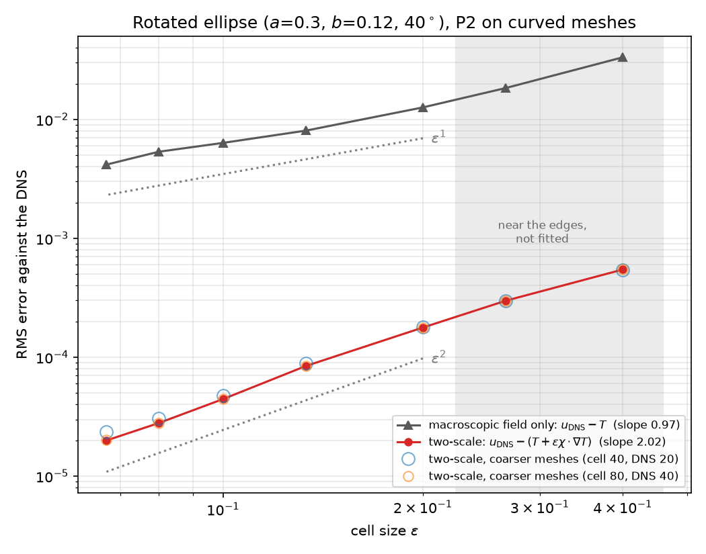
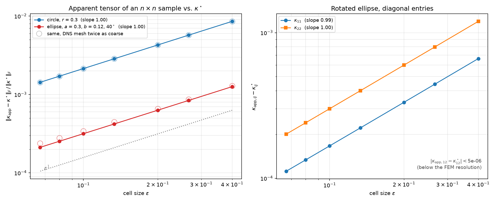
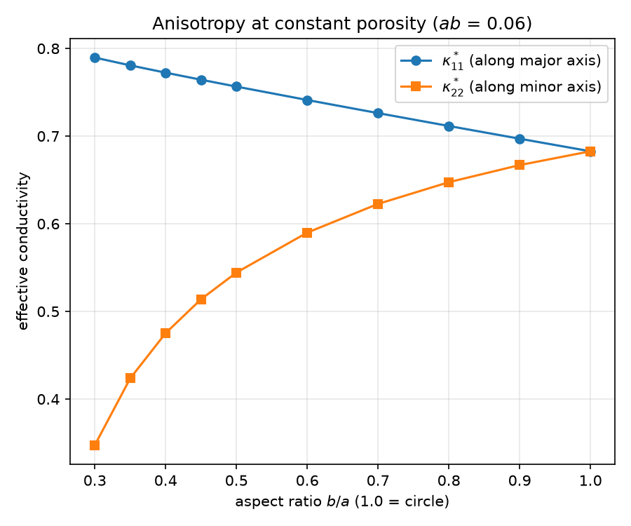
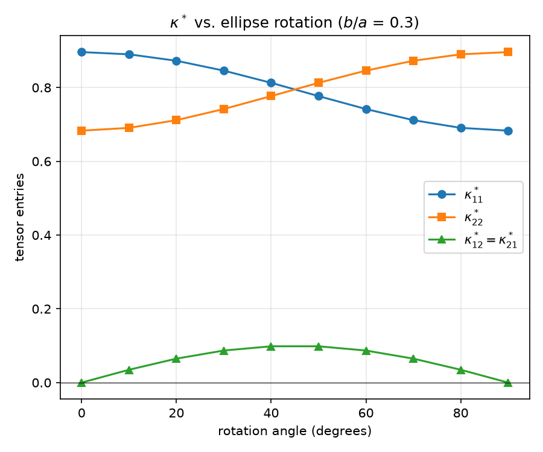
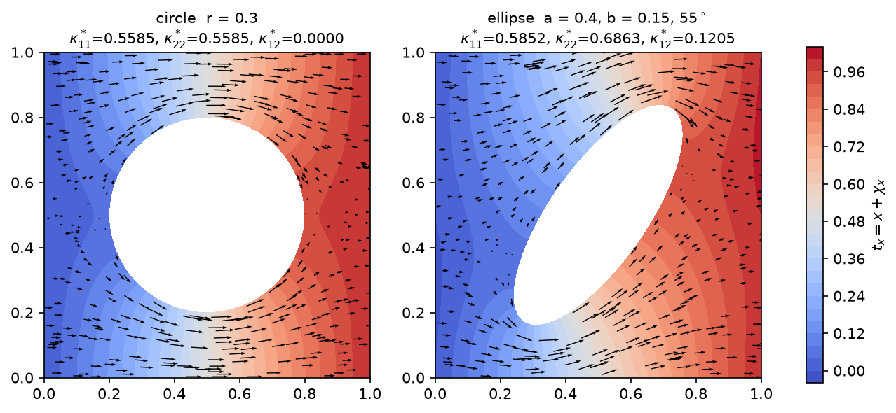

# Periodic homogenization of heat conduction in perforated plates

First-order two-scale homogenization of steady-state heat conduction in a plate perforated by a
periodic array of insulating holes, implemented with [FEniCSx](https://fenicsproject.org) and
gmsh, and **validated against direct numerical simulation (DNS)** of the fully perforated plate.

**Main result.** With quadratic finite elements on curved meshes, refined until the answer stops
changing, the error of the two-scale reconstruction $T+\varepsilon\chi\cdot\nabla T$ against the
DNS decays as $O(\varepsilon^{2.02})$, while the macroscopic field $T$ alone is only
$O(\varepsilon^{0.97})$: the corrector raises the order of accuracy from one to two, as the
asymptotic expansion predicts.

<p align="center">
  
</p>

The work was carried out from June to August 2026, and the report was last updated in November 2026.
The full write-up is in [`report/homogenization_report.pdf`](report/homogenization_report.pdf), with its LaTeX source next to it.

## The method in brief

Let $\varepsilon$ be the cell size and $Y=[0,1]^2$ the unit cell with one hole. The fine-scale
temperature is approximated by

$$
u^\varepsilon(x) \approx T(x) + \varepsilon \sum_{j=1}^{2} \chi_j\left(\left\lbrace \tfrac{x}{\varepsilon}\right\rbrace\right)\frac{\partial T}{\partial x_j}(x),
$$

where the **correctors** $\chi_j$ solve a periodic problem on the unit cell only,

$$
\nabla\cdot\big(\kappa\,(e_j+\nabla\chi_j)\big)=0 \ \text{ in } Y_{\text{solid}},\qquad
\kappa\,(e_j+\nabla\chi_j)\cdot n = 0 \ \text{ on the hole},\qquad \chi_j \ \ Y\text{-periodic},
$$

the **effective tensor** is the cell-averaged flux

$$
\kappa^\star_{ij}=\frac{1}{|Y|}\int_{Y_{\text{solid}}}\kappa\,(e_j+\nabla\chi_j)\cdot e_i\,dx ,
$$

and the **macroscopic field** $T$ solves $\nabla\cdot(\kappa^\star\nabla T)=0$ on a plain, hole-free
mesh. The microstructure is meshed once, on a single cell, however many holes the real plate has.

| Step | Function (`src/homogenization/solver.py`) |
|---|---|
| 1. cell problems (periodic BCs via `dolfinx_mpc`) | `solve_corrector` |
| 2. effective tensor $\kappa^\star$ | `compute_effective_tensor` |
| 3. macro solve with $\kappa^\star$ | `solve_macro` |
| 4. fine-scale reconstruction | `reconstruct_fine_scale` |
| benchmark: DNS on the perforated plate | `solve_heat`, `apparent_tensor` |

All solves use **P2 elements on curved (second-order) meshes** by default.

## Results

Every number and figure below is produced by the scripts in `scripts/`; the raw data of the two
convergence studies is in `results/`.

### 1. The two-scale reconstruction is second-order accurate

`04_homogenization_error.py` solves the DNS on an exact $n\times n$ tiling of the unit cell
($\varepsilon = 0.8/n$, $n = 2,\dots,12$; Dirichlet $u=0$, $u=1$ on the left and right edges,
insulated top, bottom and holes), and compares it on a $40\times40$ grid of interior points with
$T$ and with $T+\varepsilon\chi\cdot\nabla T$ (figure above). The hole is a rotated ellipse
($a=0.3$, $b=0.12$, $40^\circ$).

| fitted over $n\ge4$ | rate | at $n=12$ |
|---|---|---|
| $\text{RMS}(u_{\text{DNS}}-T)$ | $\varepsilon^{0.97}$ | $4.2\times10^{-3}$ |
| $\text{RMS}\big(u_{\text{DNS}}-(T+\varepsilon\chi\cdot\nabla T)\big)$ | $\varepsilon^{2.02}$ | $2.0\times10^{-5}$ |

The cell and DNS meshes are refined in three levels; between the last two, the two-scale error
changes by 0.05-1% at every $\varepsilon$, so what is plotted is the homogenization error, not the
FEM error. Points with $n=2,3$ are left out of the fit because the sampling region then lies
within one cell of the Dirichlet edges, where boundary layers matter.

Why not a circle? For a centred circular hole with these boundary conditions, the reconstruction
$x/L + (\varepsilon/L)\,\chi_x(x/\varepsilon)$ is an *exact* solution of the DNS problem (by mirror
symmetry $\chi_x$ vanishes on the cell faces $x=0,1$ and $\partial_y\chi_x$ on $y=0,1$). The
homogenization error is then zero and a circle only measures FEM error.

### 2. The measured conductivity tensor converges to $\kappa^\star$

`05_tensor_convergence.py` measures the full conductivity tensor of a finite $n\times n$ sample:
two DNS solves with $u = x_j$ imposed on the whole outer boundary, then the volume-averaged flux
(`apparent_tensor`). This sample tensor is an upper bound for $\kappa^\star$ and differs from it
by a boundary layer of width $\sim\varepsilon$, so it should converge at $O(\varepsilon)$.

<p align="center">
  
</p>

| $\lVert\kappa_{\text{app}}-\kappa^\star\rVert_F/\lVert\kappa^\star\rVert_F$ | rate | $n=2$ | $n=12$ |
|---|---|---|---|
| circle, $r=0.3$ | $\varepsilon^{1.00}$ | $8.6\times10^{-3}$ | $1.4\times10^{-3}$ |
| rotated ellipse | $\varepsilon^{1.00}$ | $1.3\times10^{-3}$ | $2.1\times10^{-4}$ |

No plateau: the difference keeps shrinking with $\varepsilon$. For the ellipse both diagonal entries
converge at rate 1, $\kappa_{\text{app}}-\kappa^\star$ is positive definite in every run, and the
off-diagonal entry is reproduced to better than $5\times10^{-6}$. The coarse and fine DNS meshes
(element size $\varepsilon/30$ and $\varepsilon/60$) agree to 0.1% for the circle and 12% for the
ellipse; since these quantities converge like $h^4$, the fine level is within about 1% of the
mesh-converged value.

### 3. Effect of hole shape on $\kappa^\star$

At constant hole area (constant porosity), stretching an ellipse along $x$ raises
$\kappa^\star_{11}$ and lowers $\kappa^\star_{22}$. Rotating it generates $\kappa^\star_{12}$, which
vanishes at $0^\circ$ and $90^\circ$ and peaks at $45^\circ$. `02_ellipse_sweeps.py`.

<p align="center">
  
  
</p>

<p align="center">
  
</p>

*Unit-cell solution under a unit gradient along $x$: temperature $t_x = x + \chi_x$ and heat flux.
For the tilted ellipse the flux is deflected sideways, which is what $\kappa^\star_{12}\neq0$
records (`03_cell_fields.py`).*

### Why P2 on curved meshes

The DNS mesh must resolve every hole, so its element size is tied to $\varepsilon$ and its
*relative* error does not shrink as $\varepsilon\to0$. With linear elements this error sat above
the homogenization error, and any comparison with the DNS plateaued. For instance, for a circle
the effective conductivity measured from the DNS differed from $\kappa^\star_{11}$ by a constant
$0.6\%$ at every $\varepsilon$, all of it discretization error since the circle's homogenization
error is zero (see above). P2 elements on the same meshes bring this to $5\times10^{-5}$. Curved
elements are needed too: a hole meshed with straight edges is a polygon, whose $O(h^2)$ geometric
error caps the accuracy whatever the element degree.

## Repository layout

```
src/homogenization/
    geometry.py      gmsh -> dolfinx meshes: unit cell, exact periodic tiling, perforated plate (+3D cube)
    solver.py        FEM: DNS, apparent tensor, correctors, effective tensor, macro solve,
                     reconstruction, ParaView export
    validation.py    DNS-vs-homogenization error metrics
scripts/
    01_effective_tensor.py       full pipeline for one hole shape (+ optional DNS check)
    02_ellipse_sweeps.py         kappa* vs aspect ratio (constant area) and vs rotation
    03_cell_fields.py            unit-cell temperature and flux plots
    04_homogenization_error.py   main result: field error of T and of T + eps chi.grad T
    05_tensor_convergence.py     sample tensor from the DNS vs kappa*
    06_mesh_figure.py            rendering of the curved P2 DNS mesh (gmsh only)
    07_boundary_layer.py         boundary layer of the affine-BC problem: O(eps) thickness
results/             raw data of scripts 04, 05 and 07
tests/               checks on the cell problem and kappa* (periodicity, symmetry, trends, P2 vs P1)
report/              LaTeX report
figures/             figures, TikZ sources of the diagrams in figures/diagrams/ (see figures/README.md)
```

## Installation

FEniCSx, `dolfinx_mpc` and gmsh come from conda-forge; the environment file also installs this
package in editable mode:

```bash
conda env create -f environment.yml
conda activate homogenization
```

Results were produced with Python 3.12, `dolfinx` 0.11, `dolfinx_mpc` 0.11 and gmsh 4.15 from conda-forge.
The code uses the recent `dolfinx` API (`petsc_options_prefix`, `dolfinx.io.gmsh`), so an older
`dolfinx` will likely not work.

## Usage

Approximate run times on two CPU cores:

| Command | Time | Output |
|---|---|---|
| `python scripts/01_effective_tensor.py [--dns]` | seconds | `output/*.xdmf` (open in ParaView) |
| `python scripts/02_ellipse_sweeps.py` | ~10 s | `figures/ellipse_*.png` |
| `python scripts/03_cell_fields.py` | seconds | `figures/cell_fields.png` |
| `python scripts/04_homogenization_error.py [--quick]` | ~10 min | `figures/homogenization_error.png`, `results/homogenization_error.csv` |
| `python scripts/05_tensor_convergence.py [--quick]` | ~25 min | `figures/tensor_convergence.png`, `results/tensor_convergence.csv` |
| `python scripts/06_mesh_figure.py` | seconds | `figures/perforated_rectangle_mesh.pdf` |
| `python scripts/07_boundary_layer.py` | ~5 min | `figures/boundary_layer_profile.png`, `results/boundary_layer_*` |
| `pytest` | ~5 s | |

Scripts 04, 05 and 07 take `--plot-only` to redraw their figure from the saved CSV. `make figures`
runs everything.

Hole geometry is set by constants at the top of each script, in unit-cell units:
`hole_radius` is the semi-axis $a$ along local $x$, `hole_radius_b` the semi-axis $b$ (`None` gives a
circle), and `hole_rotation_deg` rotates the ellipse counter-clockwise. A minimal example:

```python
from homogenization.geometry import make_unit_cell
from homogenization.solver import solve_corrector, compute_effective_tensor

mesh, _, facets = make_unit_cell(hole_radius=0.4, hole_radius_b=0.15,
                                 hole_rotation_deg=55.0, mesh_ratio=150)
tx = solve_corrector(mesh, facets, "x")
ty = solve_corrector(mesh, facets, "y")
print(compute_effective_tensor(mesh, tx, ty))
# [[0.58518 0.12053]
#  [0.12053 0.68634]]
```

## Building the report

```bash
cd report && latexmk -pdf homogenization_report.tex
```

The report reads its figures from `figures/`. Four of them (gmsh and ParaView renderings) are not
produced by the scripts; see [`figures/README.md`](figures/README.md).

## Limitations and possible extensions

- **Boundary tagging** in `geometry._tag_boundaries_2d` classifies edges as "min" or "max" by
  comparing against $0.5$, so it assumes the domain lies in $[0,L]^2$ with $L>0.5$, and that holes
  are smooth closed curves that do not touch the cell boundary (semi-axes below $0.5$). Polygonal
  holes and smaller domains need a more careful classification.
- Only $n\le12$ cells per side were run. The largest DNS has about $10^6$ curved P2 triangles.
- One elliptical hole is studied in detail; other shapes, a source term, or non-constant boundary
  data would test the second-order rate more broadly.
- No runtime comparison of DNS vs. homogenization is included.
- 3D: `geometry.make_perforated_cube` builds the mesh, but the solvers are 2D only.

## License

MIT, see [`LICENSE`](LICENSE).
